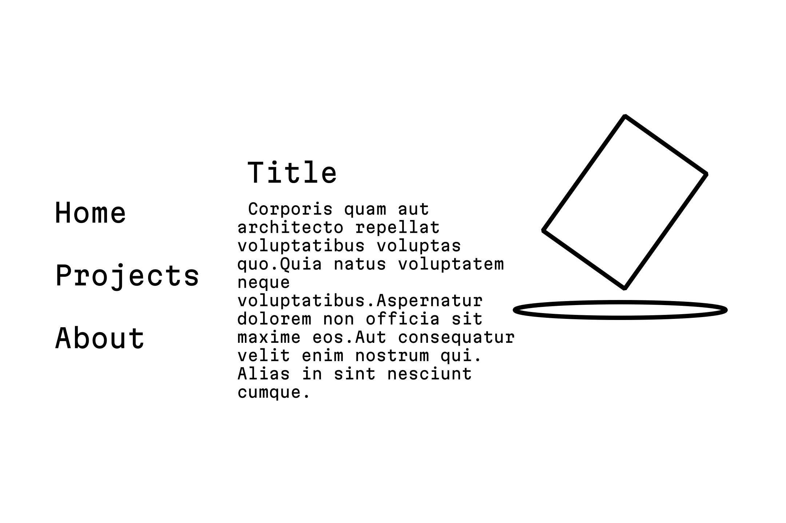

# The Official Vexruna Website
## Overview
This is my personal portfolio website.
My current stack goal is ``react``, ``typescript`` and ``three.js``.
## Idea
The site will be using 3D models aligned to center-right side of the viewport.

On the left side there will be a navigation column of **home**, **projects** and **about** categories and more.

Clicking those categories will open a list of website sections that can be vertically scrolled.
You can go back to the main list by clicking the back button.

Scrolling or clicking those sections will also scroll the center of the screen by snapping between those entries instead of slowly dragging the text up and down.

Center of the screen will contain text of the selected section.

The home tab will have a brief introduction describing who I am and what I do with a rotating business card with my logo on it displayed next to it.

Projects tab will be a list of things I worked on, either by accompanied with a unique model or with a playing card designed after the project it describes (e.g. [Hexmoon](https://github.com/hexmoon-dev) is a tarot card with its logo on the back).

About section tells about the website with links to my socials and this GitHub repository.
For its model I am considering using a radio transmitter.

In the future, for my discography tab the model will be a functioning oscilloscope with the list containing cover art images and titles. Clicking them would play the songs and albums.

# Site structure

1. Home tab
	1. Title
	2. Description
	3. Image/3D
2. Projects tab
	1. Project
		1. Title 
		2. Description
		3. Image/3D
	2. Other project
		1. Title
		2. Description
		3. Image/3D
3.  About tab
	1. Title
	2. Description
	3. Image/3D
## Dev Roadmap

My development strategy can be summarized like this: 
1. ~~Make a sketch of the layout in Krita.~~ 
	
:2. ~~Build the site using html/css/js knowledge I already have.~~ 
2. Learn a piece of the stack and rewrite the site using it.
3. Repeat for every other piece of the stack until the stack is complete.